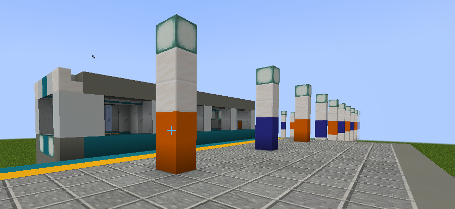
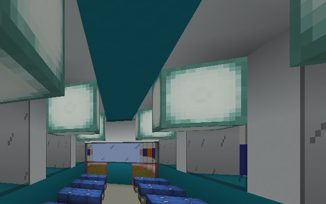
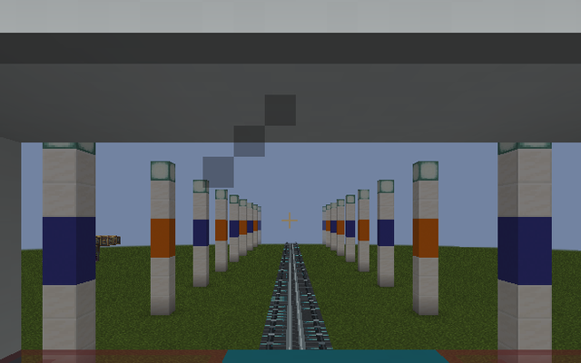
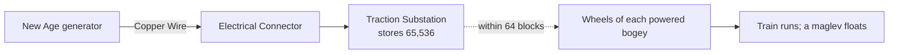

# Create: Maglev wiki

Create: Maglev adds electric railways to Create on Minecraft 1.20.1 (Fabric). You build trackside **Traction Substations** that store electricity from Create: New Age, then upgrade your trains with powered bogeys: **electric**, **bullet**, and finally **maglev**, which floats above its own guideway.

 

*A full-size maglev passenger car at its station, inside, and looking out of the rear window while it moves. The carriage body is ordinary blocks; Create: Maglev supplies the bogeys, the guideway, and the power.*

Numbers on these pages are the defaults. Server owners can change them; see [Configuration](Configuration.md).

## Download and install

Download the jar from the [latest release](https://github.com/betizzel/create-maglev/releases/latest) and put it in your `mods` folder, replacing any older Create: Maglev jar. Back up your worlds first. On a server, install it on the server and on every player's game.

| You also need | Tested version |
| --- | --- |
| Minecraft with Fabric Loader | 1.20.1, Loader 0.19.5 |
| Fabric API | 0.92.6+1.20.1 |
| Create (Fabric) | 6.0.8.1 |
| Create: New Age | 1.2.0 |
| Forge Config API Port | 8.0.2 (Create needs it too) |

## How trains are powered

A Create: Maglev train carries no fuel and no battery. Its power comes from the line, like a real railway's overhead wire or third rail.

1. A Create: New Age generator makes electricity. Copper Wire carries it to an Electrical Connector attached to a Traction Substation, which stores it.
2. Every tick, each Create: Maglev bogey on a train draws energy from substations within 64 blocks of its wheels. A bogey uses a little energy even when stopped, and much more at speed.
3. With enough power, the train runs normally: Create's own Train Controls, stations, and schedules drive it. A powered all-maglev train floats a quarter of a block above its guideway.
4. With too little power, the train slows to the speed its supply can sustain.
5. With no power, the train brakes to a stop, and a maglev settles onto its guideway. It moves again as soon as power returns.

Trains built only from Create's own bogeys are not affected and need no power.

## Pages

- [Getting Started](Getting-Started.md): build your first electric train, step by step.
- [Traction Power](Traction-Power.md): substations, range, energy use, and planning a line.
- [Trains and Tiers](Trains-and-Tiers.md): speeds, which bogey runs on which track, curves, braking, and levitation.
- [Recipes](Recipes.md): the whole crafting chain.
- [Troubleshooting](Troubleshooting.md): a train that won't move, a substation that won't charge, a maglev that won't float.
- [Configuration](Configuration.md): server settings.

## In-game help

- **Ponder:** hover over a substation, a bogey, Reinforced Standard Track, Maglev Guideway, or a Levitation Module and hold the Ponder key (W by default).
- **Engineer's Goggles:** look at a substation to see its charge, breaker state, output, and range.
- **Train Controls:** while you drive, the action bar explains anything that keeps the train from full power.
- **Advancements:** the *Create: Maglev* tab follows the progression from steel to riding a levitating maglev.
