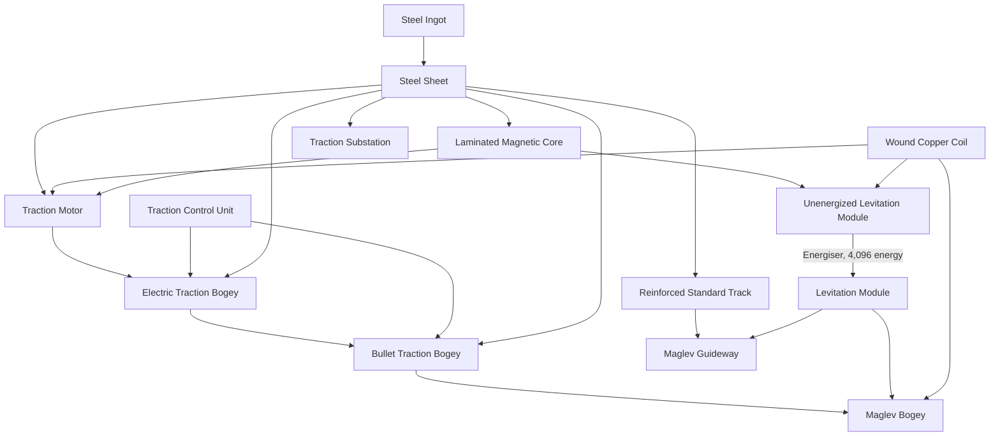

# Recipes

Every slot that takes a Steel Sheet also accepts any other item tagged `c:steel_plates`. Overcharged Iron, Overcharged Iron Sheets, Magnetite Blocks, Layered Magnets, Copper Wire, Carbon Brushes, Generator Coils, Electrical Connectors, and Energisers come from Create: New Age.

## Steel

- **Steel Ingot:** heated mixing (a Mechanical Mixer over a Basin, with a lit Blaze Burner beneath) of 1 Iron Ingot and 1 Coal.
- **Steel Sheet:** press 1 Steel Ingot with a Mechanical Press.

## Parts

**Laminated Magnetic Core** (crafting table):

| | | |
| --- | --- | --- |
| Magnetite Block | Steel Sheet | Magnetite Block |
| Steel Sheet | | Steel Sheet |
| Magnetite Block | Steel Sheet | Magnetite Block |

**Wound Copper Coil:** sequenced assembly starting from Copper Wire, two loops of: deploy a Shaft, deploy Copper Wire, press.

**Traction Motor:** sequenced assembly starting from a Steel Sheet, one loop of: deploy a Wound Copper Coil, deploy a Laminated Magnetic Core, press.

**Traction Control Unit** (crafting table):

| | | |
| --- | --- | --- |
| Redstone | Electron Tube | Redstone |
| Overcharged Iron | Andesite Casing | Overcharged Iron |
| Redstone | Electron Tube | Redstone |

**Unenergized Levitation Module** (crafting table):

| | | |
| --- | --- | --- |
| | Overcharged Iron Sheet | |
| Laminated Magnetic Core | Layered Magnet | Wound Copper Coil |
| | Overcharged Iron Sheet | |

**Levitation Module:** process one Unenergized Levitation Module in a Create: New Age Energiser, using 4,096 energy.

## Traction Substation

Crafting table:

| | | |
| --- | --- | --- |
| Carbon Brushes | Steel Sheet | Carbon Brushes |
| Copper Wire | Generator Coil | Copper Wire |
| Steel Sheet | Electrical Connector | Steel Sheet |

## Bogeys

Each bogey is a single loop of sequenced assembly, deploying three items in order.

| Bogey | Start with | Deploy |
| --- | --- | --- |
| Electric Traction Bogey | Train Casing | Steel Sheet, Traction Motor, Traction Control Unit |
| Bullet Traction Bogey | Electric Traction Bogey | Steel Sheet, Overcharged Iron Sheet, Traction Control Unit |
| Maglev Bogey | Bullet Traction Bogey | Levitation Module, Overcharged Iron Sheet, Wound Copper Coil |

## Track

**Reinforced Standard Track** (crafting table, makes 2):

| | | |
| --- | --- | --- |
| Steel Sheet | | Steel Sheet |
| Train Track | Steel Sheet | Train Track |
| Steel Sheet | | Steel Sheet |

**Maglev Guideway** (crafting table, makes 8): eight Reinforced Standard Track around one Levitation Module.
