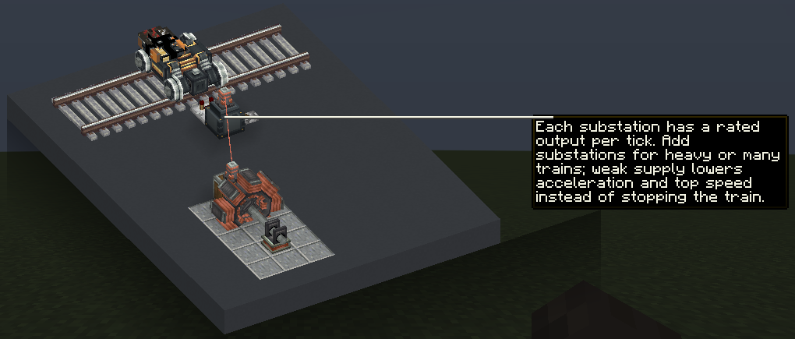
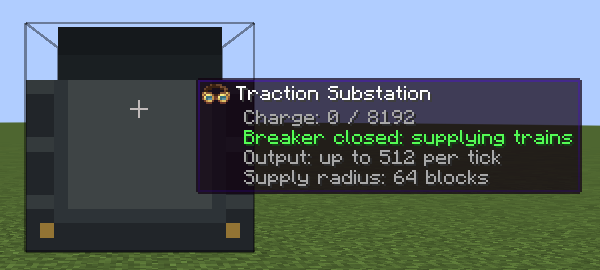

# Traction power

*The substation Ponder scene: a generator feeds the substation, which powers the bogey on the nearby track.*

## Charging a substation

- A Traction Substation accepts Create: New Age electricity on any side, usually through an Electrical Connector attached to it and wired to a generator with Copper Wire.
- It stores up to **65,536** energy.
- It only takes energy in. Other machines cannot draw from it; its energy is for trains.
- A redstone signal opens its **breaker**. An open breaker stops charging and stops supplying trains, but keeps the stored energy. Remove the signal to close the breaker again.

To read a substation:

- Right-click it with an empty hand for a status line: charge, breaker, output, and range.
- Look at it wearing Engineer's Goggles.
- Place a comparator against it. The signal runs from 0 when empty to 15 when full.

*The goggles readout. This screenshot comes from a test world whose substations store 8,192; the default is 65,536.*

## How a train draws power

- Every Create: Maglev bogey has two **pickups**, one at each of its wheel positions. Each pickup must be within **64 blocks** of a substation whose breaker is closed, measured as a straight line in three dimensions.
- If any pickup on the train is out of range, the whole train has no power.
- Each pickup draws from its nearest substation first. When that one is empty or at its output limit, the pickup draws the rest from the next nearest. Overlapping substations therefore add both backup and capacity.
- Each substation delivers at most **512** energy per tick in total, shared by every train it powers.
- Substations and trains keep working in unloaded chunks. Create keeps running unattended trains there, and their power keeps working too.

## Energy use

Each bogey draws this much energy every tick:

`idle + ceil(speed² × coefficient)`

Here, speed is in blocks per tick (blocks per second divided by 20). The idle draws are 8, 16, and 32, and the coefficients are 4, 6, and 8, for electric, bullet, and maglev bogeys respectively.

| Speed | Electric bogey | Bullet bogey | Maglev bogey |
| --- | --- | --- | --- |
| Stopped | 8 | 16 | 32 |
| 20 blocks/s | 12 | 22 | 40 |
| 40 blocks/s | 24 | 40 | 64 |
| 60 blocks/s | n/a | 70 | 104 |
| 80 blocks/s | n/a | n/a | 160 |

Multiply by the number of bogeys. A two-bogey train at its top speed draws 48 (electric), 140 (bullet), or 320 (maglev) per tick. While accelerating, a train pays for the speed it is accelerating to.

Bogeys draw their idle energy even when the train is stopped, as long as they are in range of a working substation. A maglev uses it to keep floating.

## When power runs short

| Supply | What the train does | Action bar message |
| --- | --- | --- |
| Covers the full draw | Runs normally | None |
| Less than the full draw, but at least the idle draw | Accelerates more slowly; its speed settles where the supply covers its draw | "Weak traction supply: acceleration and top speed are reduced." |
| Less than the idle draw, or a pickup out of range | Brakes to a stop, and a maglev lowers onto its guideway. No energy is used | "No traction power. Connect or charge an enabled substation within 64 blocks." |

Trains also look ahead. They brake early for unpowered track, curves, and the end of the track, so they don't run into them too fast.

## Planning a line

These figures use the default settings.

- **Spacing:** a substation right beside a straight track covers about 128 blocks of it. Place substations closer together than that so their ranges overlap, and closer still if they stand away from the track or at a different height. Every pickup on a train must be covered at once, so long trains need generous overlap.
- **Running cost:** a two-bogey maglev at 80 blocks/s draws 320 per tick. It passes through one substation's 128 blocks in about 1.6 seconds, taking about 10,000 energy from it. A full substation covers about six such passes before it needs recharging.
- **Output:** that same train fits within one substation's 512 per tick. Two of them in the same range at once would need 640, so they would run on weak supply unless another substation's range overlaps.
- **Parked trains:** idle draw adds up. A parked two-bogey maglev uses 64 per tick and empties a full substation in under a minute; a parked two-bogey electric train empties one in under four minutes. Park in a depot whose substation you can switch off with redstone, such as a lever or Redstone Link, and switch it back on before the train leaves. An unpowered train waits safely, and a maglev rests on its guideway.
