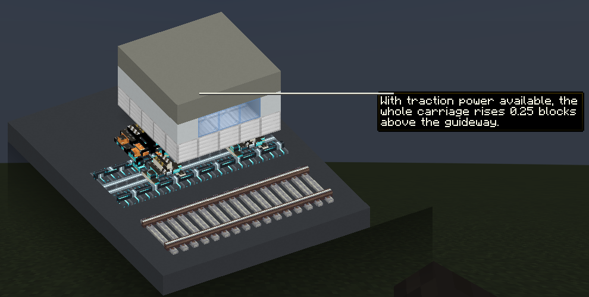

# Trains and tiers

| Tier | Bogey | Runs on | Top speed | Acceleration | Idle draw per bogey |
| --- | --- | --- | --- | --- | --- |
| Create | Create's own bogeys | Standard track | Create's normal speed (28 blocks/s by default) | Create's normal | None; no power needed |
| Electric | Electric Traction Bogey | Train Track or Reinforced Standard Track | 40 blocks/s (144 km/h) | 5 blocks/s² | 8 |
| Bullet | Bullet Traction Bogey | Train Track or Reinforced Standard Track | 60 blocks/s (216 km/h) on Reinforced Standard Track, 40 blocks/s elsewhere | 6 blocks/s² | 16 |
| Maglev | Maglev Bogey | Maglev Guideway only | 80 blocks/s (288 km/h) | 8 blocks/s² | 32 |

Top speeds assume straight track and full power, and one block per metre. When you drive by hand with Train Controls, Create runs trains somewhat slower than on a schedule.

## Track

- **Reinforced Standard Track** is standard track. Create's bogeys, electric bogeys, and bullet bogeys all run on it, but only bullet bogeys go faster on it.
- **Maglev Guideway** is its own kind of track, and only Maglev Bogeys work on it. A Maglev Bogey on any other track, or an electric or bullet bogey on guideway, gets no power, and the train won't move. The action bar shows "This bogey is incompatible with the current track material."

## Mixing bogeys

- A train runs at the pace of its slowest bogey. Electric and bullet bogeys together run as an electric train. A single Create bogey holds the train to Create's normal speed, while its powered bogeys still need power.
- Don't mix maglev and wheeled bogeys in one train. They need different track, so the train can never get power.
- Only an all-maglev train floats.

## Curves

A train may take a curve of radius *r* blocks at √(25 × *r*) blocks/s, and it is always allowed at least 20 blocks/s:

| Curve radius | Speed limit |
| --- | --- |
| 16 blocks or tighter | 20 blocks/s |
| 36 blocks | 30 blocks/s |
| 64 blocks | 40 blocks/s |
| 144 blocks | 60 blocks/s |
| 256 blocks | 80 blocks/s |

Trains brake ahead of a curve to its limit, so wide curves keep fast lines fast. Slopes and S-bends are limited by their tightest point.

## Braking

When a train loses power, it brakes at 16 blocks/s². From 80 blocks/s, it stops in 5 seconds over about 200 blocks; from 40 blocks/s, in 2.5 seconds over about 50 blocks. Trains also brake ahead of time for unpowered track, curves, and the end of the track.

## Levitation

- A powered all-maglev train lifts its whole carriage 0.25 blocks above the guideway, rising over about a second.
- When power is lost, it brakes and settles back onto the guideway.
- A levitating maglev hums instead of making wheel-on-rail sounds. Electric and bullet trains don't puff steam.
